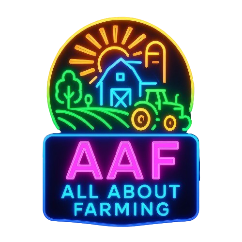

  
  <h1 align='center'>AAFBot Rev.2 Discord bot written in Rust</h1>

Powering All About Farming Discord server!

The bot's codebase resides in [`crates/bot`](./crates/bot/src) directory while [`crates/shared`](./crates/shared/src) directory is also used by the [aaf.farm](https://aaf.farm) website too

Notable features;-
- Autoresponder
- FS22/FS25 scanners
- Leaderboard system
- Birthday announcement system
- *rest to be determined due to slow development*
